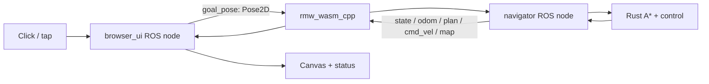

# ROS2WASM redesign plan

The browser must execute actual ROS 2 code. The former design shared Rust with a native
ROS application but did not meet that browser requirement. This plan supersedes the
[original plan](docs/history/v1-plan.md). The small map, A*, replaceable goals, minimal UI,
Docker workflow, good explanations, and three target layouts remain the scope.

## Required outcome

The published static page loads a ROS 2 Humble `rcl` runtime and the ROS2WASM project's
`rmw_wasm_cpp` middleware, compiled with Emscripten. At least two real ROS nodes exchange
typed messages. Goal messages must cause navigation through an actual subscription;
rendered state must come back through an actual ROS publication/subscription. Rust
continues to implement the planner and controller. A JavaScript imitation of nodes or
a separate native ROS backend cannot satisfy this outcome.

## Architecture decision

Use two WASM modules in the same tab:
1. Rust navigation engine: existing A*, robot geometry, motion and fixed ticks.
2. ROS runtime: upstream `rcl`, message introspection, ROS2WASM middleware and a thin
   C++ adapter. It creates `browser_ui` and `navigator` nodes using `rcl_node_init`.

The C++ layer uses the low-level `rcl` API shared by ROS client libraries. This is actual
ROS 2 node/publisher/subscriber code, not a Rust ROS client library. The browser adapter
initializes both modules and connects their function boundaries. The navigator's ROS
subscription handler invokes Rust; the UI never sends goals directly to Rust.



Both ROS nodes share one WASM runtime/context and execute cooperatively on one browser
thread. They do not need Web Workers or OS threads to demonstrate typed pub/sub. The
selected upstream middleware supports in-module local delivery, so no external router,
WebSocket service, or COOP/COEP headers are required. This must be proven on the actual
GitHub Pages subpath, not inferred from a local server.

## Explicit middleware limits

Upstream describes ROS2WASM as experimental and lists topics and services as supported,
but actions, parameters, and QoS as unsupported. This MVP uses topics. It must not claim
Nav2 actions, production DDS behavior, standard graph-discovery completeness, host CLI
connectivity, or a physical robot connection. The prior native Jazzy/rclpy application
may remain as a separate CLI learning reference; its action/QoS capabilities do not
establish browser capabilities.

## Interface contract

All world positions are metres in the map frame; yaw is radians. The map/controller
geometry from v1 remains unchanged: 30×20 cells at 0.4 m, robot radius 0.18 m + 0.03 m
margin, cardinal A*, Manhattan heuristic, fixed 20 ms ticks, turn then translate.

| Topic | Type | Publisher → subscriber | Purpose |
| --- | --- | --- | --- |
| `/goal_pose` | `geometry_msgs/msg/Pose2D` | browser_ui → navigator | New destination; theta ignored |
| `/control` | `std_msgs/msg/UInt8` | browser_ui → navigator | Reset, pause, resume, cancel |
| `/state` | `std_msgs/msg/String` | navigator → browser_ui | JSON render snapshot including map and goal lifecycle |
| `/map` | `nav_msgs/msg/OccupancyGrid` | navigator → browser_ui | Raw obstacle geometry |
| `/plan` | `nav_msgs/msg/Path` | navigator → browser_ui | Full planned cell-centre route |
| `/odom` | `nav_msgs/msg/Odometry` | navigator → browser_ui | Perfect simulated map-frame pose and body velocity |
| `/cmd_vel` | `geometry_msgs/msg/Twist` | navigator → browser_ui | Observed simulated velocity |

The structured topics exercise ROS message definitions; `/state` carries the small
renderer-specific snapshot without inventing a new custom message generator. Middleware
delivery counters come from actual publish/take operations. Node/topic labels in the
learning panel must come from initialized handles, not an invented graph visualization.

## Goal and scheduling behavior

1. A pointer is converted through the same map scale/letterbox used for rendering.
2. `browser_ui` publishes a typed Pose2D through `rcl_publish`.
3. Cooperative processing calls `rcl_take` on the navigator's goal subscription.
4. Only that handler invokes Rust `nav_goal`; its validation/reachability transaction
   preserves the old route on failure and replaces it atomically on success.
5. At each fixed step, the navigator advances Rust and publishes state/telemetry.
6. `browser_ui` takes state messages and the renderer consumes that received snapshot.
7. Pause/reset/resume follow the control topic through the same real middleware.

New valid goals work during motion and pause. Rejected/unreachable goals leave the
active route unchanged. There are no asynchronous planning tasks to resurrect an old
route. Cancellation clears the route and velocity. Browser hidden-tab timing remains
explicit; ROS functions must not block the UI waiting for messages.

## Milestones and release gates

### R0 — Source-based feasibility
- Pin upstream repository commits in `ros2_wasm/vendor.lock.json`.
- Build ROS, introspection and middleware from source in a pinned Emscripten Docker image.
- Document portability patches individually; never replace ROS implementation with stubs.
- Create two real rcl nodes; publish/take a typed Pose2D in Chrome.
- Gate: runtime reports `rmw_wasm_cpp`, actual node names and matching sent/received values.

### R1 — Make ROS own navigation delivery
- Attach the Rust module to subscription handlers and fixed-step navigation.
- Publish actual state/telemetry and read back the received state for rendering.
- Gate: temporarily removing the goal subscription prevents a goal from starting motion.
  Cosmetic ROS publishers alongside a direct Rust UI path fail this gate.
- Keep independent A*/clearance/goal-state tests and native/WASM parity.

### R2 — Minimal UI and meaningful browser evidence
- Preserve map, short status, Pause/Reset; show browser ROS runtime in the badge.
- Put live node/topic names and delivery counters in the existing learning disclosure.
- Extend Chrome tests to assert real middleware identity and pub/sub progress.
- Exercise goal replacement, rejection, pause/replacement/resume, arrival, reset,
  keyboard input, orientation changes and startup errors.
- Gate: laptop 1365×900, portrait 390×844, landscape 844×390 all pass; inspect screenshots.

### R3 — Docker, documentation and release
- Docker builds both WASM outputs and nginx serves only static assets.
- Reuse a dependency build stage so changing the thin wrapper does not rebuild all ROS.
- Include upstream license notices with the distributed ROS runtime.
- Rewrite README, architecture, decisions and learning exercises around browser ROS.
- Distinguish browser-local middleware from native DDS and its optional reference demo.
- CI rebuilds sources, runs core/parity/browser checks, then deploys Pages.
- Gate: tests pass against public HTTPS project URL, not just Docker localhost.
- Record exact source/deployment/test evidence and remaining limits in verification.md.

## Validation commands

```bash
cargo test --locked --workspace
npm run build
npm run test:parity
docker compose up --build -d web
BASE_URL=http://127.0.0.1:8080 npm test
BASE_URL=https://leonardo-maglanoc.com/ros2-navigation-lab/ npm test
```

The browser-runtime Docker build and artifact extraction are integrated into the build
scripts after R0 passed. The public replacement is gated on Docker and deployed-site tests.

## Teach-back checkpoints

Explain which code initializes real ROS nodes, which call publishes a goal, which call
delivers it to Rust, and which subscription supplies the canvas state. Explain why a Rust
WASM module alone was insufficient, what `rcl` and `rmw` do, why the two nodes can live
in one module, and which standard ROS features this experimental middleware lacks.

## Status

R0, R1 and R2 passed: two real rcl nodes, typed ROS delivery, required-subscription fault
test, and 15 Chrome tests across all three layouts. R3 Docker packaging and documentation
are complete; the Docker-served app also passed 15/15. Public deployment verification
is pending. Historical v1 tests are retained as prior evidence, not proof of the new runtime.
