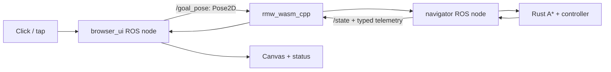

# Navigation Lab — ROS 2 in your browser

Click a destination, watch a robot plan with A*, and change its goal while it moves.
**Actual ROS 2 nodes run inside the browser**, compiled to WebAssembly using
[ROS2WASM](https://ros2wasm.dev/). Rust implements the planner, controller and simulator;
a thin C++ ROS layer carries goals and state between two real nodes.

**[Live demo](https://leonardo-maglanoc.com/ros2-navigation-lab/)** ·
[Architecture](docs/architecture.md) · [Learn ROS 2](docs/learning.md) ·
[Plan](PLAN.md) · [Verification](docs/verification.md)

No remote ROS server, Zenoh router, rosbridge service or local installation is required
for visitors. GitHub Pages serves two WASM modules and a small HTML/CSS/JavaScript UI.

## What runs where



Both nodes, the ROS `rcl` library, and ROS2WASM middleware execute in a WASM module in
this tab. The Rust engine executes in another WASM module. The navigator's actual ROS
subscription handler calls Rust; the canvas reads state received through a ROS
subscription. JavaScript handles input, rendering, scheduling and the module boundary.

This is a small ROS teaching application, not Nav2. Browser-local ROS2WASM transport
is experimental: this project does not claim production DDS interoperability, ROS
actions, parameter services or QoS guarantees. See [the exact boundary](docs/architecture.md).

## Try it

- Click or tap open space to set a goal; tap elsewhere to replace it during motion.
- Goals snap to 0.4 m cells. Walls and the light clearance band are blocked.
- Pause holds the robot. You can replace its goal while paused, then Resume.
- Reset returns it to the start. Invalid/unreachable requests preserve the current route.
- Keyboard: focus the map, choose a cell with arrow keys, then press Enter.
- Expand **How it works** to inspect live node names, topic types and delivery counts.

The UI stays small: one map, one status line, Pause and Reset. It adapts to laptop,
phone portrait, and phone landscape. A short viewport letterboxes the map instead of
distorting its world coordinates.

## Run with Docker

Prerequisites: Git and Docker Engine/Desktop with Compose v2. Host Rust, ROS and Node
are not required for this path. The first build compiles ROS dependencies from source
and can take several minutes; later app edits reuse the dependency layer.

```bash
git clone https://github.com/LeoMaglanoc/ros2-navigation-lab.git
cd ros2-navigation-lab
docker compose up --build -d web
```

Open [localhost:8080](http://localhost:8080). Stop with:

```bash
docker compose down
```

Docker builds the Rust engine and actual ROS2WASM runtime, then serves only static files
from nginx. It does **not** leave a native ROS backend running behind the website.
The reference build environment is Linux x86_64; physical phones need only a browser.

## Development and tests

For a local Rust/JS workflow, install rustup, Node.js 22, Python 3 and Docker. Docker is
still used to cross-compile the ROS runtime; there is no hidden host ROS dependency.

```bash
npm ci
cargo test --locked --workspace
npm run build
npm run test:parity
npm test
```

The pinned Rust compiler/target comes from `rust-toolchain.toml`. `npm run build` builds
Rust and invokes `scripts/build-browser-ros.sh`, which builds/extracts the ROS artifacts
from Docker. Output goes to ignored `dist/` and `.ros2wasm-build/` directories.

Browser tests use **Google Chrome**:

```bash
npx playwright install --with-deps chrome
# Against the Docker website:
BASE_URL=http://127.0.0.1:8080 npm test
# Against the deployed project subpath:
BASE_URL=https://leonardo-maglanoc.com/ros2-navigation-lab/ npm test
```

Without `BASE_URL`, tests start a temporary Python server on port 4173. A normal local
preview can be started with `python3 -m http.server 8080 --directory dist`.

### Evidence that ROS is actually involved

The Chrome suite checks live `rmw_get_implementation_identifier()` output, initialized
rcl node names, typed topic delivery, a received 600-cell map, a received planned path,
and moving odometry. A separate test calls `rcl_subscription_fini` on the actual goal
subscription: clicks then cannot start navigation. Recreating the subscription restores
navigation. This catches an accidental direct UI-to-Rust bypass.

The suite also checks goal replacement, rejection, pause/replacement/resume, arrival,
reset, keyboard input and orientation changes across three layouts. Phone coverage is
Chrome viewport/touch emulation, not physical iOS/Android certification.

Rust tests independently compare A* with uniform-cost search on 400 seeded maps and
check continuous grid-edge footprint clearance, speed bounds and goal ownership.
Native/WASM parity checks the shared algorithm, separately from ROS middleware behavior.

## Nodes and topics

| Topic | Type | Direction |
| --- | --- | --- |
| `/goal_pose` | `geometry_msgs/msg/Pose2D` | browser_ui → navigator |
| `/control` | `std_msgs/msg/UInt8` | browser_ui → navigator |
| `/state` | `std_msgs/msg/String` | navigator → browser_ui |
| `/map` | `nav_msgs/msg/OccupancyGrid` | navigator → browser_ui |
| `/plan` | `nav_msgs/msg/Path` | navigator → browser_ui |
| `/odom` | `nav_msgs/msg/Odometry` | navigator → browser_ui |
| `/cmd_vel` | `geometry_msgs/msg/Twist` | navigator → browser_ui |

The C++ adapter uses ROS 2's low-level `rcl` API, with explicit cooperative publish/take
processing. It does not port `rclrs` into the browser or reimplement ROS in JavaScript.
Both nodes share a runtime/context. `rmw_wasm_cpp` handles typed message conversion and
browser-local delivery; no external network middleware is needed for this arrangement.

Read [the interface contract](docs/architecture.md#interfaces) for rates, frames, units,
control codes, timestamps and unsupported features. The [learning guide](docs/learning.md)
traces one goal and explains how to interpret the live counts.

## Repository map

| Path | Purpose |
| --- | --- |
| `crates/nav-core/` | Rust grid, A*, footprint, controller, simulator and scalar ABI |
| `ros2_wasm/src/browser_navigation/` | Real browser ROS nodes and typed pub/sub adapter |
| `ros2_wasm/vendor.lock.json` | Exact upstream ROS/ROS2WASM source commits |
| `ros2_wasm/scripts/` | Source fetching, documented portability patches and license collection |
| `web/` | Minimal UI, renderer, fixed-step clock and WASM module boundary |
| `tests/` | Chrome behavior/ROS checks, Rust parity and native-reference ROS acceptance |
| `Dockerfile`, `compose.yaml` | Browser build/server and optional native-reference environment |
| `docs/`, `AGENTS.md`, `PLAN.md` | Architecture, decisions, exercises, verification and working rules |
| `ros2_ws/` | Optional native Jazzy/rclpy reference, separate from the browser runtime |

## Optional native ROS reference

The earlier native ROS adapter remains available for CLI/action/QoS/TF exercises. It
uses the same Rust algorithms, but has a different ROS graph and richer native middleware.
It is **not** what executes the browser demo. See [native reference](docs/native-reference.md).

## Deployment and upstream code

GitHub Actions builds the Rust and ROS2WASM artifacts, runs Chrome and core checks,
checks the native reference, then deploys static output to Pages on `main`. PRs run
checks without deployment; documentation-only changes do not redeploy. All runtime
assets use relative URLs, so the portfolio project subpath works.

For a fork: enable **Settings → Pages → Source → GitHub Actions**, update the repository
and live-demo links, then push to `main`. No router or backend secret is required.

The ROS runtime is built from pinned upstream source, not downloaded demo binaries.
[Build notes](docs/build-notes.md) document the few cross-compilation fixes and why they
exist. License/notice texts are included in the static `licenses/` directory. Project
code is [MIT](LICENSE); upstream components retain their respective licenses.

## Deliberate simplifications

The map is fixed and known, the pose is perfect, the robot turns in place before driving,
and A* finds shortest cardinal grid length rather than fastest motion. There is no
SLAM, laser sensor, final-heading constraint, wheel/dynamics model or physical driver.
The browser schedules fixed 20 ms simulation steps and discards hidden-tab catch-up.
This is neither a real-time system nor a complete ROS distribution in a tab.

The [v1 design](docs/history/v1-readme.md) kept ROS native and was superseded because
browser-executed ROS is a requirement. Current behavior and evidence are documented
in the main docs, not inferred from those historical tests.
