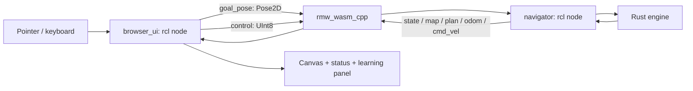

# Architecture: actual ROS 2 in the browser

This architecture supersedes the native-only ROS boundary in v1. The public browser
application executes real ROS 2 `rcl` node code and upstream `rmw_wasm_cpp` middleware.
Rust still owns navigation. No remote backend is needed for browser-local delivery.

## Components and ownership

| Component | Executes | Owns |
| --- | --- | --- |
| `nav_core.wasm` | Browser WASM instance | Grid, inflation, A*, goal/route state, controller and simulator |
| `ros_navigation.wasm` | Browser WASM instance | Real rcl nodes, typed publishers/subscribers, message conversion and handling |
| `ros_navigation.js` | Browser JS | Emscripten's generated runtime/loader |
| `ros-runtime.js` | Browser JS | Module initialization and scalar/JSON boundary to Rust |
| `app.js` + Canvas | Browser JS | Pointer/keyboard conversion, rendering, UI and fixed-step scheduling |
| Docker/Actions | Build environment | Source cross-compilation, tests, static hosting output |

The C++ application uses low-level `rcl`, the ROS client-library foundation. It does not
claim that Rust ROS bindings run in the browser. A thin C++ layer is an explicit tradeoff
that keeps ROS execution genuine while retaining the Rust planner/controller.

## Actual ROS graph

Both nodes are created with `rcl_node_init` and share one context in one WASM instance.
Each topic has a real `rcl_publisher_t` and `rcl_subscription_t`; the adapter calls
`rcl_publish` and `rcl_take`. ROS2WASM performs introspection-based YAML serialization
and routes to its registered local subscribers. No JavaScript replacement topic bus is
used. This in-module transport is provided by the pinned upstream middleware source.

The browser event loop drives cooperative processing; there are no OS threads, pthreads,
SharedArrayBuffer, Web Workers, Asyncify, or external routers in this design. Processing
never waits for a future message: a take with no message returns and the UI can continue.

This is not a complete DDS network in a browser. The selected experimental middleware
has incomplete graph discovery and does not support actions, parameters or QoS policy
guarantees. Live names/counters in the learning panel come from the initialized handles
and actual publish/take operations, not from a claim of complete ROS graph introspection.

## One click, end to end

1. `app.js` converts canvas position to world metres using the rendering scale/letterbox.
2. Its runtime adapter calls the C++ `ros_goal` export, not Rust `nav_goal`.
3. `browser_ui` publishes `geometry_msgs/msg/Pose2D` on `/goal_pose`.
4. The navigator takes that message through `rcl_take`.
5. Its subscription handler invokes Rust through a small Emscripten host import.
6. Rust validates/snaps the goal and runs A*. On success it atomically replaces the route;
   invalid/blocked/unreachable requests leave the current route untouched.
7. The navigator publishes a typed `/plan` and a `/state` rendering snapshot.
8. `browser_ui` takes the state message. The renderer reads that received JSON, never the
   Rust engine's private state directly.
9. Each fixed step advances navigation and publishes state; odom/velocity publish every
   fifth step. Arrival updates the state received by the UI.

The C++ layer holds no duplicate planner or controller. `ros-runtime.js` privately owns
the raw Rust instance and supplies its methods only to the ROS module's handlers.

## Interfaces

Every topic below has one publisher and one subscriber. Labels are root-relative inside
this browser context. There is no automatic connection to a host ROS domain or CLI.

| Topic | Type | From → to | Publication schedule | Meaning |
| --- | --- | --- | --- | --- |
| `/goal_pose` | `geometry_msgs/msg/Pose2D` | browser_ui → navigator | Every destination request | x/y metres in implicit map frame; theta ignored |
| `/control` | `std_msgs/msg/UInt8` | browser_ui → navigator | Startup/reset/pause/resume | 0 reset, 1 pause, 2 resume, 3 cancel |
| `/state` | `std_msgs/msg/String` | navigator → browser_ui | Each step and immediate command/goal processing | JSON snapshot for the renderer; state and accepted goal_id included |
| `/map` | `nav_msgs/msg/OccupancyGrid` | navigator → browser_ui | Startup and reset | 30×20, 0.4 m cells, 0 free/100 occupied, map frame |
| `/plan` | `nav_msgs/msg/Path` | navigator → browser_ui | Startup/reset, successful goal, cancel | Full cell-centre route in map frame |
| `/odom` | `nav_msgs/msg/Odometry` | navigator → browser_ui | Every fifth step, plus controls | Perfect pose in map; child base_link; body-frame twist |
| `/cmd_vel` | `geometry_msgs/msg/Twist` | navigator → browser_ui | Every fifth step, plus controls | Observed forward linear.x (m/s), yaw angular.z (rad/s) |

A nominal 50 Hz simulation makes odom/velocity nominally 10 Hz. The ROS layer is polled
by the browser schedule, not a ROS executor timer. Message timestamps are simulation
elapsed time derived from Rust ticks (`ticks / 50`); reset returns this time to zero.
No `/clock` publisher or native-system-time synchronization is claimed.

The raw map is distinct from the inflated planning mask. `/plan` remains the complete
accepted route after arrival and is cleared on cancel/reset. `/cmd_vel` is an observation
output, not an external motor command input. Pose is ideal ground truth, not localization
or noisy odometry. All covariance fields stay zero in this idealized model.

No `/scan` is fabricated. There is no browser `/tf` broadcaster because all geometry is
already expressed in one known map frame. The optional native reference has a separate
TF/action/QoS graph; its interfaces must not be presented as browser capabilities.

`/state` is a renderer-specific JSON payload inside an actual standard ROS String message.
The typed map/path/odometry/velocity publications independently exercise ordinary message
schemas. This avoids a custom message-generator package for a small UI snapshot.

## Goal lifecycle and ordering

`ros_goal` publishes and processes available goal messages in one synchronous cooperative
turn. There is no asynchronous planning job or transport between machines in this MVP.
A valid reachable replacement takes control immediately. Accepted `goal_id` increments
only on successful planning; rejected requests keep every active-engine field unchanged.

| Request | Behavior |
| --- | --- |
| Nonfinite/outside map | Return code 1; preserve active route |
| Occupied/clearance-blocked | Return code 2; preserve active route |
| Free but disconnected | Return code 3; preserve active route |
| Reachable | Return code 0; replace goal/path atomically |
| No ROS subscription delivery | Return code 4; no navigation callback runs |

The UI reports these outcomes; they are application-level goal semantics over a topic,
not ROS action results. No `NavigateToPose` action is implemented in the browser.

Engine states are idle, moving, arrived and canceled. Pause is orthogonal: the robot
holds position/zero velocity, accepts a replacement route, and follows it on Resume.
Reset restores initial pose and engine counters. ROS delivery counters remain cumulative
for the lifetime of the tab, making transport evidence distinguishable from simulation state.

## Geometry and controller

- World: 12×8 m, 30×20 cells at 0.4 m. Origin bottom left, +x right, +y up; yaw CCW.
- Row-major index: `floor(y/0.4)*30 + floor(x/0.4)`; goals use cell centres.
- Robot disc radius 0.18 m plus 0.03 m margin. A centre is blocked when its Euclidean
  distance to an occupied cell rectangle is at most 0.21 m.
- Four-connected A*, unit edge costs, consistent Manhattan heuristic. Queue ties are
  deterministic `(f,g,cell_id)`. No diagonal corner cutting or route smoothing.
- Fixed step 0.02 s; maximum forward speed 0.9 m/s and yaw rate 3 rad/s. Turn in place
  before translating; clip each final segment step to avoid overshoot.
- A replacement route first returns to the current cell centre along the current cardinal
  segment. Brief backtracking is deliberate; it preserves the clearance argument.
- Arrival is at the final centre with 1e-9 m numerical tolerance and no final-yaw requirement.
- Shortest refers to grid length, not fastest traversal with turning costs.

Exact swept-disc distance tests cover every admissible cardinal grid edge against every
occupied rectangle. That guarantee relies on this grid/controller model; adding diagonal
segments or smoothing would require a new collision analysis.

## Module ABI and memory

The Rust scalar ABI is unchanged. Its snapshot pointer is borrowed until the next snapshot
call; the JS boundary immediately copies bytes from the current WASM memory buffer.
The ROS module receives that ASCII JSON and sends it as a ROS String. Its snapshot export
points to the UI subscriber's saved String, which JavaScript immediately copies/parses.
The two WASM instances do not share memory or assume Rust/C++ struct layout compatibility.
All calls are serialized on the browser thread.

The renderer drives a fixed-step accumulator from animation frames, caps catch-up to
100 ms/frame, and discards hidden-tab time. Heavy load slows simulation; this is not
real-time control. Static assets use URLs relative to the module, preserving the GitHub
Pages repository subpath without custom server headers.

## Evidence and failure behavior

Startup verifies actual middleware identity and two initialized node handles before
showing the ready UI. A failed ROS load displays an error; there is no silent standalone
fallback. Chrome tests inspect received typed messages and remove/recreate the actual
goal subscription to prove ROS is required for behavior. Test-only fault injection is
exposed to the harness only when the page is opened with `?test=1`.

The learning panel's counters are adapter observations, not DDS acknowledgments or QoS
measurements. See verification.md for executed checks and build-notes.md for the exact
source pins/portability fixes. Native-reference capabilities are documented separately.
