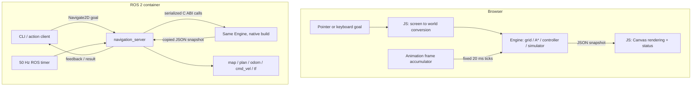
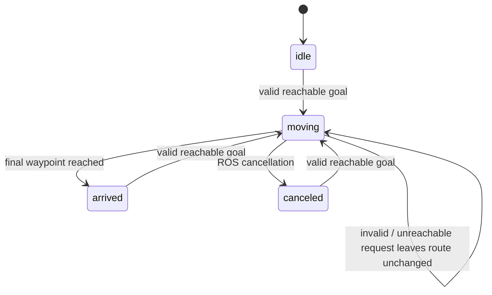

> Historical v1 record, superseded by the ROS2WASM redesign. This does not describe the current browser architecture.

# Architecture and behavioral contract

## Runtime boundary

The core is one dependency-light Rust crate. `cdylib` produces a `.wasm` for the browser
and a `.so` for Linux. Neither build depends on ROS. Browser JavaScript calls scalar
exports; ROS Python calls the same exports using `ctypes`. Both copy a JSON snapshot
immediately after requesting it. The snapshot pointer remains valid only until the next
snapshot call. All calls are serialized. The ABI is internal to the repository and ships
with both adapters; it is not a stable external plugin API.

| Runtime | Executes | Communications | Required infrastructure |
| --- | --- | --- | --- |
| Browser | Rust WASM + HTML/CSS/JS | Function calls and copied snapshots | Any static HTTP host |
| ROS Docker | Native Rust `.so` + rclpy | DDS topics and ROS action protocol | Linux container running Jazzy |
| GitHub Actions | Rust, Node/Chrome, Docker | Build/test/deploy | GitHub-hosted runner |

The public website does not execute ROS 2 middleware. The native ROS application is
an independently runnable demonstration of the identical planner/controller. No claim
of browser-native ROS is necessary or made.

## Ownership and data flow

One ROS node owns the engine. The planner, controller, and simulator are logical modules,
not automatically separate ROS processes. The `SingleThreadedExecutor` serializes all
callbacks. The action server uses a `ReentrantCallbackGroup` so a suspended execution
coroutine does not prevent goal/cancel service callbacks. It awaits a `rclpy.task.Future`;
the timer or a newer goal resolves it. There are no sleeps in callbacks, Python worker
threads, or asynchronous planning jobs.

## Map, geometry, and motion

- World: 12 × 8 m; grid: 30 × 20; resolution: 0.4 m/cell. Origin `(0,0)` is bottom left.
- All public coordinates are metres and radians. Positive yaw is counterclockwise.
- `id = floor(y / 0.4) * 30 + floor(x / 0.4)`; a cell centre is
  `((column + 0.5) * 0.4, (row + 0.5) * 0.4)`.
- Canvas y points down. Input and rendering flip it exactly once. The drawing is
  letterboxed when needed; pointer conversion subtracts the same offset.
- Occupied cells are closed axis-aligned rectangles. The robot is a disc of radius
  0.18 m, with a further 0.03 m clearance margin.
- A cell is blocked when its centre's Euclidean distance to an occupied rectangle is
  at most 0.21 m. On this particular uniform cardinal grid, this conservatively excludes
  the adjacent cell band. Raw occupied cells and inflated cells are shown differently.
- Four-connected motion, no diagonals and no corner cutting. A* unit edge costs and
  Manhattan heuristic make the heuristic consistent. Deterministic queue ties use
  `(f, g, cell_id)` order; stale cost entries are ignored.
- Start: `(1.4,1.4,0)`. Max forward speed: 0.9 m/s. Max yaw rate: 3 rad/s.
- Fixed `dt = 0.02 s`. First turn in place toward a waypoint, then translate along its
  segment, clipping the final step to land on the waypoint without overshoot.
- No acceleration, momentum, wheel geometry, localization, or final yaw requirement.
- Replanning starts in the robot's current cell. The first waypoint is that cell's centre;
  it may briefly backtrack along the current cardinal segment before following the new
  route. This is deliberate and avoids diagonal shortcuts during goal replacement.
- The clearance argument relies on these cardinal segment and uniform-grid constraints.
  A future smoothing/diagonal controller would need segment-level swept-disc checks.

The controller can rotate and move in separate ticks. It never translates while rotating.
`path_length` includes the return to the current cell centre at replan time, whereas A*
optimality refers only to the grid route from start cell to goal cell.

## Goal lifecycle

Pause is an orthogonal browser flag. While paused the robot stays fixed and its velocity
is zero, but a valid new goal can replace its route. Resume follows the newest route.
Reset constructs a fresh engine, including ticks, metrics, and goal IDs.

Goal transaction:
1. Reject nonfinite/out-of-bounds coordinates.
2. Reject occupied/clearance-blocked destination cells.
3. Search from the current robot cell to the destination cell centre.
4. If no route exists, leave every field of the current engine unchanged.
5. On success, replace path and goal together, increment `goal_id`, reset waypoint,
   and zero instantaneous velocity. No old route remains scheduled.

Browser errors are shown as text and preserve the current route. A same-cell goal
is allowed and returns to that cell centre. Arrival uses the final centre position,
with floating-point positional tolerance `1e-9 m`; reaching the goal does not constrain yaw.

ROS lifecycle:
- Invalid/blocked requests are rejected at action admission.
- A geometrically valid but disconnected goal is accepted, then aborted with a no-route
  result. Its failure does not preempt the existing goal.
- A newer reachable goal aborts the previous action with a “Superseded” message.
  There is no `PREEMPTED` terminal state in the ROS 2 action protocol.
- Canceling the current goal clears its path, zeros velocity, and ends it as canceled.
- Only the active action ID can stop motion. Old execute coroutines only return their
  own saved results and never mutate the engine.

## ROS interfaces

Names below assume the default root namespace. The action type is deliberately custom,
not `nav2_msgs/action/NavigateToPose`: this project does not implement Nav2's stack or
promise its semantics.

| Interface | Type | Producer → consumer | Rate / QoS | Frame / units |
| --- | --- | --- | --- | --- |
| `/navigate_2d` | `navigation_interfaces/action/Navigate2D` | CLI/client ↔ navigation_server | On demand; feedback 10 Hz; standard rclpy action QoS | Goal x/y in map metres; feedback x/y/metres remaining |
| `/map` | `nav_msgs/msg/OccupancyGrid` | navigation_server → inspection/RViz | Once at start; reliable, transient local, depth 1 | map; origin identity; 0 free, 100 occupied |
| `/plan` | `nav_msgs/msg/Path` | navigation_server → inspection/RViz | Startup, accepted reachable goal, cancel; reliable, transient local, depth 1 | map; full planned cell-centre route |
| `/odom` | `nav_msgs/msg/Odometry` | navigation_server → observer | 50 Hz; reliable, volatile, depth 10 | header map, child base_link; metres, rad, m/s, rad/s |
| `/cmd_vel` | `geometry_msgs/msg/Twist` | navigation_server → observer | 50 Hz; reliable, volatile, depth 10 | body-frame forward linear.x, yaw angular.z |
| `/tf` | `tf2_msgs/msg/TFMessage` | TransformBroadcaster → TF listeners | 50 Hz; tf2 broadcaster defaults | map → base_link |

`/odom` names the conventional topic, but pose is perfect simulated ground truth expressed
in `map`, not noisy odometry in a separate drifting `odom` frame. The TF tree is simply
`map → base_link`. No redundant identity map→odom transform is added. Covariances remain
zero because this is an ideal simulator, not an uncertainty estimator.

`/map` is the raw geometry, not the inflated planner mask. `/plan` remains the full route
when an action succeeds; cancellation clears it. `/cmd_vel` is an observation output;
there is no separate command subscriber or simulated motor-driver node.

The action protocol also creates hidden goal/result/cancel services, feedback/status
topics, and ordinary ROS parameter infrastructure. Use `ros2 action info` rather than
inventing a separate status topic. No `/scan` exists because no range sensor is simulated.

## Timing and browser behavior

Rendering is driven by `requestAnimationFrame`; navigation advances at 50 Hz with an
accumulator. Delta time is capped at 100 ms per animation frame; hidden-tab time is
explicitly discarded. A background tab therefore cannot suddenly teleport the robot
when restored. JSON snapshots include 600 cell flags; this small fixed map needs no
worker, React, graphics framework, binding generator, or asynchronous planner.

The ROS timer advances exactly one step per callback. ROS message timestamps use the
ROS clock, not the engine tick counter. Heavy system load slows simulation relative to
wall time; this is intentionally not a real-time control implementation.

The app uses relative asset URLs, including the WASM URL resolved from `import.meta.url`.
It works at `/ros2-navigation-lab/` without hardcoded root assets, CORS, WebSockets,
SharedArrayBuffer, or custom cross-origin isolation headers.
